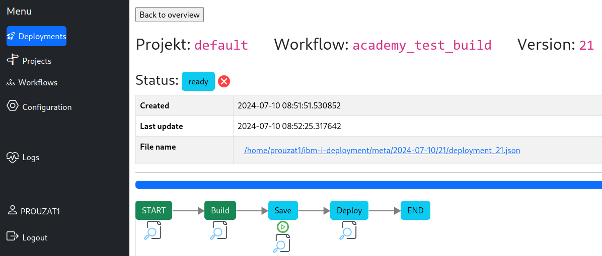
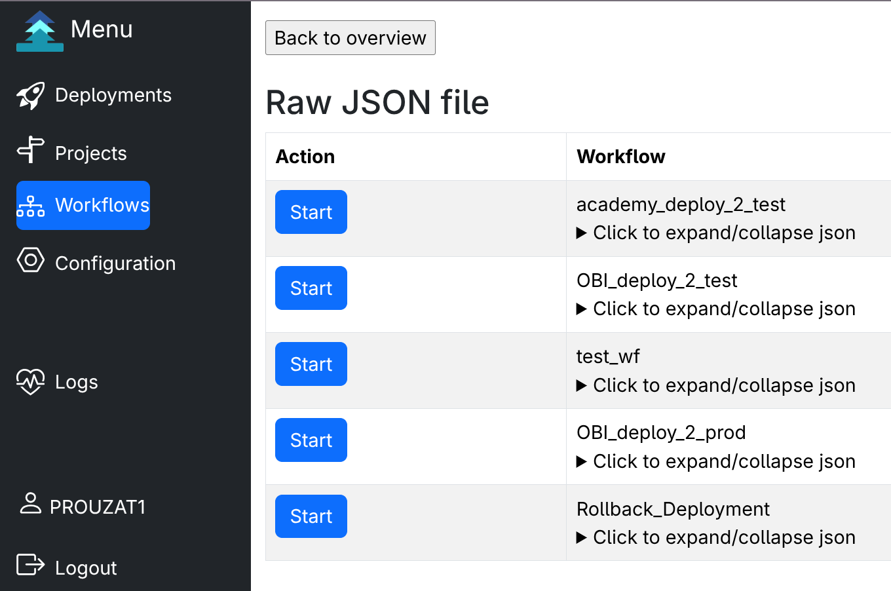
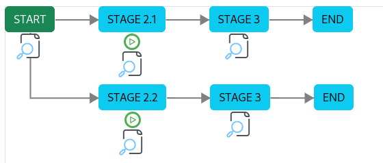
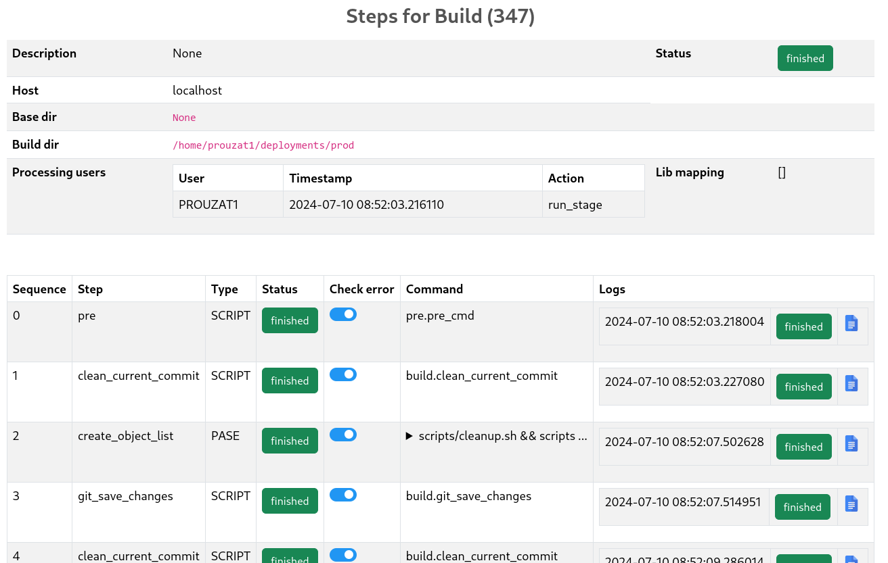
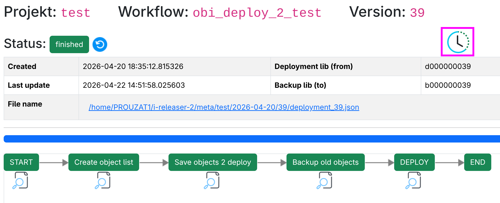
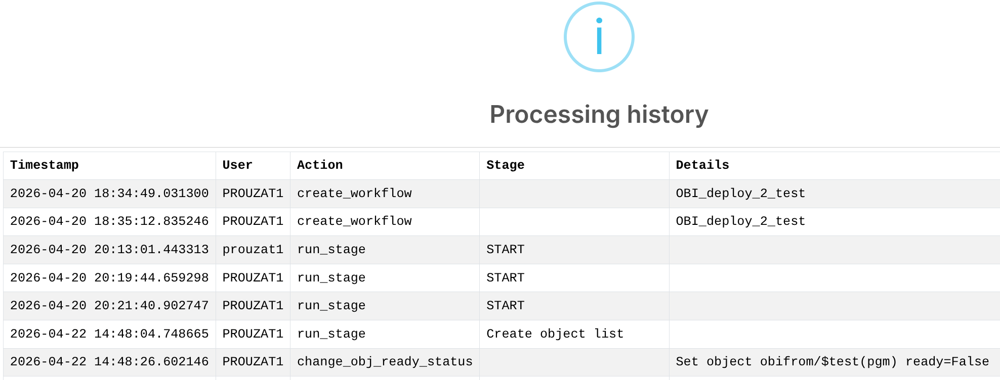
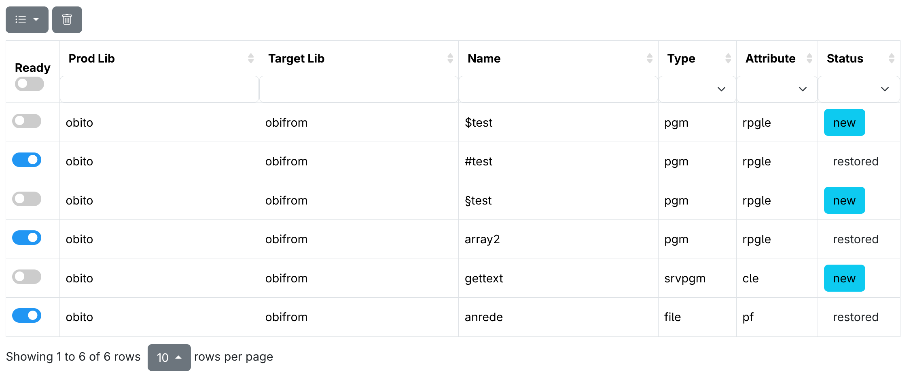
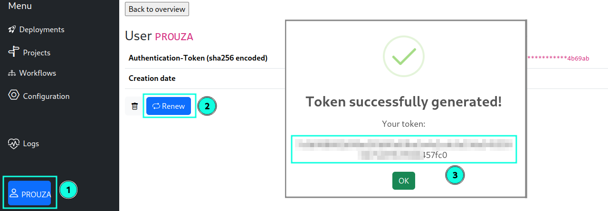
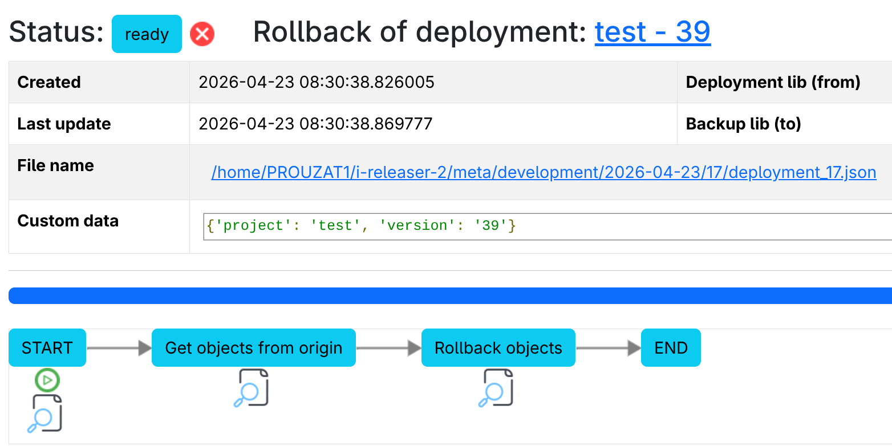
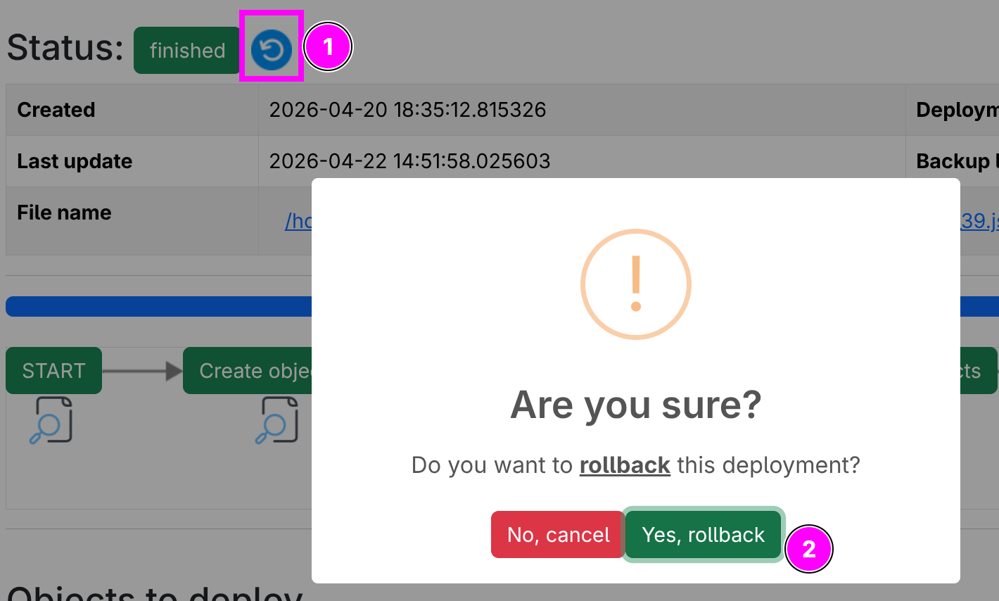

# i-Releaser

Deployment workflows for IBM i.

You define the stages a release goes through (build, test, production, ...) and what has to be done in each of them.
i-Releaser runs them from a web app or the Web API, shows the progress, and keeps the log of every step and who started it.




## Features

**Workflows**

* Your own workflows, one JSON file each, with any number of stages  
  
* Parallel branches, which can be merged again  
  
* Steps are IBM i commands (`QSYS`), shell commands (`PASE`) or Python functions (`SCRIPT`)
* Stages can run in an independent [processing service](docs/processing-service.md), so they keep running when the web server restarts
* [DB deployment](docs/db-deployment.md): deploy changes of large tables with a downtime of minutes. The table is copied in the background, changes are taken from the journal.

**Tracking**

* Status and log of each step and command  
  
* Activity history: who did what and when  
  
  
* Choose the objects to include in or exclude from a deployment  
  

**Integration and extension**

* [Web API](docs/webapi.md) for all actions, with a personal API token per user  
  
* Custom data per deployment (e.g. a Jira ticket), with fields users can edit  
  
* [Hooks](docs/workflow.md#hooks): run your own scripts when a deployment or stage changes its status
* [Jira integration](docs/jira.md): deployments appear in the Jira issue
* [Your own scripts, routes and HTML](docs/scripts.md), e.g. an automatic rollback  
  

**Operation**

* Runs under a user profile of user class `*USER`. The profile only needs the authorities your steps need.
* [Permissions](docs/permissions.md) per user and role, for all workflows, a workflow or a stage
* Deployments of a project are processed in the order of their version


## Quick start

On your IBM i, in a QSH or (better) an SSH session (see [SSH setup](https://github.com/andreas-prouza/ibm-i-build/blob/main/docs/pages/SSH.md)):

```bash
mkdir -p /apps && cd /apps
git clone https://github.com/andreas-prouza/i-releaser
cd i-releaser
./setup3.13.sh
```

Then:

1. In `etc/user_permissions.json`, replace the sample user `myuser` by your IBM i user profile (lower case).
2. Adapt the workflows in `etc/workflows/` (see [workflow configuration](docs/workflow.md)). The setup copied two samples there.
3. Start the web app:

   ```bash
   cd webapp
   ./service start
   ```

4. The web app listens on `127.0.0.1:8080` (`webapp/etc/gunicorn.conf.py`), so it's only reachable on the IBM i itself.
   For a first test, open an SSH tunnel from your PC and browse to `http://localhost:8080`:

   ```bash
   ssh -L 8080:127.0.0.1:8080 <user>@<your IBM i>
   ```

   For regular use, put a [reverse proxy with HTTPS](docs/installation.md#reverse-proxy) in front of it.
5. Log in with your IBM i user and password.

The details (requirements, all configuration files, reverse proxy, backup) are in the [installation guide](docs/installation.md).


## Documentation

| Topic | |
|---|---|
| [Installation and operation](docs/installation.md) | Requirements, setup, configuration files, starting and stopping, reverse proxy, backup, updates, troubleshooting |
| [Concepts](docs/concepts.md) | Projects, workflows, deployments, stages and steps, their status, and how a deployment runs |
| [Workflow configuration](docs/workflow.md) | Reference of the workflow files, step mappings, commands, editable fields, hooks |
| [Scripts and extensions](docs/scripts.md) | Your own Python steps, the example scripts, custom routes and HTML |
| [Permissions](docs/permissions.md) | Users, roles and what each permission allows |
| [Web API](docs/webapi.md) | All endpoints, authentication with API tokens |
| [Technical notes](docs/technik.md) | Tests, database updates, package review, decisions |
| [Processing service](docs/processing-service.md) | Run stages independent of the web server |
| [Jira integration](docs/jira.md) | Show deployments in Jira Cloud or Data Center |
| [DB deployment](docs/db-deployment.md) | Deploy changes of large tables with minimal downtime |
| [Changelog](CHANGELOG.md) | |


## How it works

```
workflow (etc/workflows/simple.json)
  │
  ├── stage START ──────► stage TEST ──────► stage PROD ──────► stage END
  │     processing steps    processing steps   processing steps
  │     pre, build          save, transfer     backup-old-objects,
  │                                            perform-deployment
  │
  └── each processing step is mapped to a command
        QSYS    an IBM i command             CRTLIB D000000042
        PASE    a shell command              scp -rp ... prod400:/deploy
        SCRIPT  a Python function            target_deployment.restore_objects_on_target
```

1. A deployment is created from a workflow (in the web app or with the Web API). It gets the next version number of its project.
2. A user runs a stage. Its steps run one after the other, and each command's output is stored.
3. When all steps of a stage are finished, its next stages become ready.
4. When the last stage is finished, the deployment is finished. Stages without steps, like `END`, finish automatically.

See [concepts](docs/concepts.md) for the details.


## Project layout

```
etc/                  Configuration (templates in etc/examples/)
  workflows/          One JSON file per workflow
modules/              Core: deployments, stages, steps, permissions
  db/                 SQLite data access and database updates
  db_deployment/      Engine of the DB deployment
scripts/              Python functions for SCRIPT steps and hooks (templates in scripts/examples/)
webapp/               Web app and Web API (FastAPI, gunicorn)
  etc/                Configuration of the web app (templates in webapp/etc/examples/)
  custom/routes/      Your own routes
serviceapp/           Processing service
tests/                Tests (`.venv/bin/pytest`)
docs/                 Documentation
var/                  Database (app.sqlite), its backups, socket and PID of the processing service
meta/                 Logs and generated files of each deployment
log/                  Logs of the processing service
```


## License

[GNU Affero General Public License v3.0](LICENSE)
