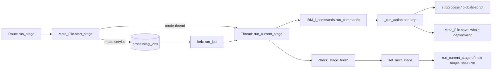
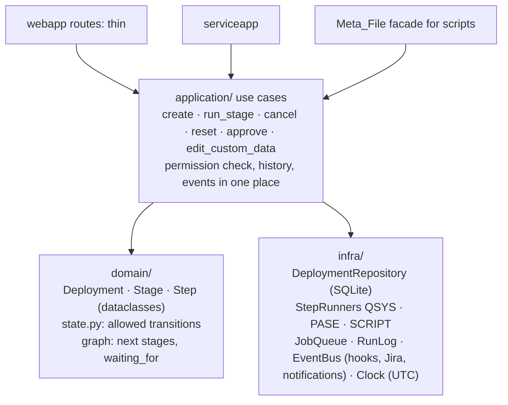
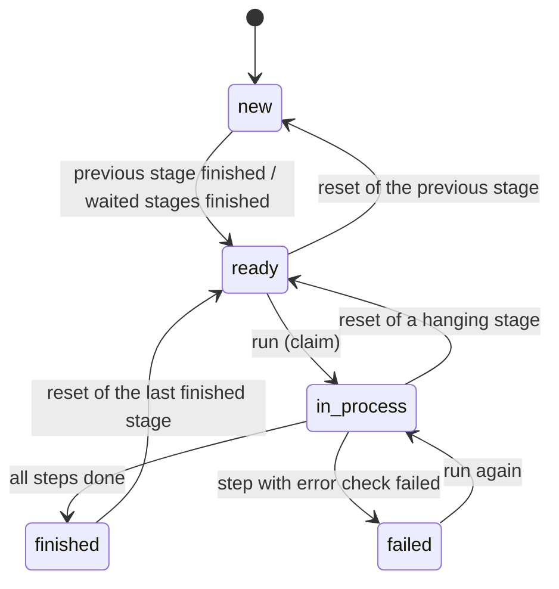

# Redesign of the core

- **Status:** ready (in progress, see [progress](#progress))
- **Type:** improvement
- **Priority:** P2
- **Source:** Code review 2026-11-23 (user request: "analyse the core, open for refactoring and redesign")

Analysis of the core (`modules/`, `modules/db/`), the problems found, the target and the plan in steps.
The app stays usable after each step; each step is tested on its own (as the [modernization of the web front end](web-ui-modernization.md)).

## Result in short

* **A redesign of the core, step by step, no rewrite.** The behaviour, the workflow files and the database stay; the inside of `Meta_File`, the saving and the running of stages change.
* **The biggest gain is correctness under concurrency:** today three mechanisms work together (the column diff `saved_values`, `refresh_state`, SQL claims). Several holes are left (see [defects](#defects-found)). In the target, a status is only changed by an atomic transition.
* **Second gain: speed.** Loading a deployment opens a connection per stage, object and step; every step saves the whole deployment.
* **Scripts keep working:** `Meta_File` stays as a facade with the attributes scripts use (`main_deploy_lib`, `deploy_objects`, `save()`, ...). It is deprecated, not removed in this redesign.

## How it was analysed

* All modules of `modules/` and `modules/db/` were read, the call chain of "run a stage" was followed from the route to `subprocess`.
* Status changes, imports, global state and the queries of a load were listed by searching the code.
* Suspected defects were checked in the code; two were reproduced (nested output capture, circular import).

## Current situation

| Area | Finding |
|---|---|
| `Meta_File` | 1,200 lines, 52 methods, 13 concerns: construction (creates the directory on every load), log setup of a run (root logger handler), persistence, state machine, graph of stages, start in thread or queue, permission (one method), deployment history, hooks, custom data, object list parser, compile list file, data and hashes for the web page ([meta_file.py](../../modules/meta_file.py)). |
| Status | No state machine. Status is changed in about 15 places: `Meta_File.set_status` (writes two tables), `Stage.set_status` (writes at once), direct assignments (`stage.status = ...`), SQL (`claim_stage`, `activate_stage`, `claim_finished`, `finish_job`). The set of "running" status exists four times. `in preperation` and `prepare` are never set. |
| Saving | Three ways for one concept: stages save at once, the deployment with `save()`, steps with `save_action_status`. `save()` compares every column of the whole tree with `saved_values` and compresses `custom_data` each time; it runs after every step. Partial updates are a [source of lost updates](../bugfixes/lost-updates-on-save.md). |
| Loading | N+1: a connection per deploy object, stage and step (and a query for the history of each step). 5 stages, 15 steps, 200 objects with 2 actions: about 600 connections and 2,300 queries per load. Every deployment route, every live update and every job loads the whole deployment. |
| Database | Foreign keys are declared but not on (`PRAGMA foreign_keys`). `stages.id` and `actions.id` have no `AUTOINCREMENT`, so deleted ids are used again (and orphaned history rows show up at the new step). Times: UTC, local time and epoch seconds mixed. Nothing is ever deleted (see [data retention](data-retention.md)). |
| Running | Two ways (thread in the web app, process of the processing service) with own checks. `run_immediate` runs the next stage recursively inside the previous one. The step loop searches the list again for every step. `SCRIPT` steps are found through `globals()` after `from scripts import *`; hooks with `importlib`. |
| Imports | Circular import `meta_file` ↔ `deploy_version` (import order matters). 8 modules in one cycle; `permission_config` imports FastAPI. |
| Configuration | `etc/constants.py` imports `etc/settings.py` with `*`, no checks; `etc/app.json` for the processing mode, read on every start of a stage. |
| Naming | "meta file" about 1,000 times, "deployment" about 500 times for the same thing. Six list classes with the same boilerplate. Typos in names and values (`IN_PREPERATION`, `TRANSVERRED`, `check_worfklow_loop`). |

## Defects found

| Priority | Defect |
|---|---|
| P1 | [A finished deployment can be canceled](../bugfixes/cancel-finished-deployment.md) |
| P2 | [Saving a deployment can overwrite newer changes](../bugfixes/lost-updates-on-save.md) |
| P2 | [A job without heartbeat is set to failed, but its process keeps running](../bugfixes/job-abort-leaves-process-running.md) |
| P2 | [Nested output capture](../bugfixes/nested-script-output-capture.md) |
| P2/P3 | [Minor code defects (review 2026-11)](../bugfixes/minor-code-defects-2026-11.md) |

The defects are fixed in the current code first (small changes). The redesign then removes their causes.

## Target

**Status only by transitions.** Each entity has a table of allowed transitions, e.g. for a stage:

A transition is one SQL statement: `UPDATE stages SET status = ?, update_time = ? WHERE id = ? AND status IN (<allowed from>)`. It returns whether it happened.
The same function serves deployments, stages, steps and jobs. `claim_stage`, `activate_stage`, `claim_finished` become rules of the table; a save never writes a status.

**Loading and writing.** A deployment is loaded with a fixed number of queries on one connection (deployment, stages, all steps of the deployment, their history with `IN (...)`, objects). A use case writes what it changes (e.g. `record_step_result(step, result)`), not the whole tree. `saved_values` is removed.

**One way to run a stage.** Every run is a job of the queue. Mode `thread` becomes a worker inside the web app which takes jobs of the same queue; mode `service` the processing service. Checks, scheduled runs and cancel are the same in both modes. Stages with `run_immediate` are added to the queue (or run in a loop) after the run, not inside it.

**Step runners.** One registry `{QSYS, PASE, SCRIPT}`. `SCRIPT` and hooks use the same resolver (`importlib`, only `scripts.*`, loaded when used).

**Facade for scripts.** `Meta_File` keeps the attributes and methods the example scripts and documented scripts use; it calls the use cases. Deprecated with a warning in the log from the release after the redesign.

## Steps

Each step: own branch, tests first for the behaviour which must stay, then the change; all tests pass after each step.

| # | Step | Content | Depends on |
|---|---|---|---|
| 1 | State machine | `modules/domain/state.py` with the tables of allowed transitions for deployment, stage, step, job. `transition()` with conditional `UPDATE`. All status changes use it; status is removed from the column lists of the saves. Removes the status `in preperation`/`prepare` (migration: none are stored, checked by the migration). | Defects of [lost updates](../bugfixes/lost-updates-on-save.md) fixed |
| 2 | Repository | Loading with a fixed number of queries; targeted writes (`record_step_result`, `add_sub_steps`, `set_custom_data`, ...); one transaction per use case (`BEGIN IMMEDIATE` where it decides). Indexes for `workflow_definitions(name)`, `meta_files(status)`, `deploy_objects(prod_lib, name, type, attribute)`. `saved_values` removed. Lists load only the columns they show. | 1 |
| 3 | One way to run | Job queue for both modes; worker thread in the web app for mode `thread`; `run_immediate` without recursion; step loop without searching the list again. | 1 |
| 4 | Step runners | Registry; one resolver for `SCRIPT` and hooks; `subprocess` handling with `with`, ending of the process group on any error. | – |
| 5 | Split `Meta_File` | Use cases in `modules/application/`, domain classes (dataclasses) in `modules/domain/`, the page data (`get_state_signature`, `get_all_data_as_dict`) in `web_modules/`, the object list parser in its own module. `Meta_File` becomes the facade. Permission checks only in the use cases (the commented decorators are removed). | 1, 2 |
| 6 | Data hygiene | All times stored in UTC with zone (ISO 8601), shown in the time zone of the browser (filter exists). Migration converts the stored local times (time zone of the server). `PRAGMA foreign_keys = ON`, `AUTOINCREMENT` for `stages` and `actions` (table rebuild), orphaned rows removed by the migration. | 2 |
| 7 | Configuration | One settings object (dataclass), checked at the start (types, ranges, unknown names). `etc/settings.py` stays the file of the user. | – |
| 8 | Naming | New code and new API ([API v2](api-v2.md)) say "deployment". Database tables and v1 keep their names. One generic list helper instead of six classes. Typos fixed with migration of stored values (`transverred`, ...). | 5 |

## Progress

| Step | Status |
|---|---|
| 1 State machine | finished 2026-11-24: `modules/state.py` (tables, the running statuses in one place), `stage_data.transition`, `meta_file_data.transition`; `Stage.set_status` and `Meta_File.set_status` use them; saves don't write the status; `deploy_versions.details` doesn't get the status anymore. Tested with `tests/test_stage_flow.py` (`TestTransitions`). Not done: the statuses `in preperation`/`prepare` are still in the enums (step 8) |
| 2 Repository | partly finished 2026-11-24: a deployment is loaded on one connection with at most 10 statements (`actions_data.Deployment_Steps`, tested with 200 objects in `tests/test_stage_flow.py`, `TestLoading`); after a `PASE`/`QSYS` step only the step is written (`Meta_File.save_step`), after a `SCRIPT` step the whole deployment (a script may change anything); indexes for `workflow_definitions(name)`, `meta_files(status)`, `deploy_objects(prod_lib, name, type, attribute)`; the deployment list doesn't load the custom data. Not done: `saved_values` still exists (status isn't part of it anymore, step 1), one transaction per use case |
| 3 One way to run | partly finished 2026-11-24: stages with `run_immediate` (and stages without steps) run one after the other after the run, not inside it; an error of one of them doesn't change the result of the run before (tested with `tests/test_stage_flow.py`, `TestRunImmediate`); the step loop doesn't search all steps again after each step; a job checks before each step that it hasn't been ended. Not done: mode `thread` as a worker of the job queue, see decisions |
| 4 Step runners | finished 2026-11-24: one resolver for `SCRIPT` steps and hooks (`modules/scripts_loader.py`: only `scripts.<file>.<function>`, loaded when used, no `from scripts import *`); the processing service loads all scripts once at its start, a script with an error is logged and only fails its steps; `subprocess` with `with`, the process group is ended on any error (tested with `tests/test_commands.py`, `tests/test_review_2026_11_modules.py`) |
| 7 Configuration | finished 2026-11-24: `modules/settings_check.py` checks type and range of the settings at the start of the web app and the processing service; an invalid value stops the start with a message, an unknown name (typo) is a warning. Instead of a settings object: `etc/constants.py` stays the place of the defaults, a test makes sure that every new setting with a number or a choice gets a check (`tests/test_settings_check.py`) |
| 5 Split `Meta_File` | partly finished 2026-11-24: the use cases of the deployments are in `modules/application/deployments.py` (create, cancel, run, reset, edit custom data, approve, objects, check error, cancel job, history), with the permission check and the history; the Web API v1 and v2 and the pages call them ([API v2](api-v2.md), tested with `tests/test_api_v2.py` and the tests of v1). Not done: domain classes, `Meta_File` as a facade, the page data in `web_modules/`, the object list parser in its own module |
| 6, 8 | open |

## Done when

* All steps are finished, all tests pass, a workflow with parallel stages, `run_immediate`, a scheduled run and the example scripts runs on an IBM i in both processing modes.
* Loading a deployment with 200 objects needs at most 10 queries (test counts them).
* `grep` finds no status assignment outside `state.py` and the loading code.

## Non-goals

* An ORM or another database (SQLAlchemy would be a new large package; SQLite stays).
* `async` for the core (the work is subprocesses and SQLite; threads and processes are enough).
* Changes of the workflow files or the script interface beyond the deprecation of `Meta_File` (scripts keep working).

## Decisions (2026-11-24)

* Step 3: mode `thread` stays a thread per run for now. A worker of the job queue inside the web app changes how runs behave after a restart of the web app (they would be aborted and could be continued automatically) and needs a test on IBM i with several gunicorn workers. It's the next part of this step.
* Step 4: the old way to inject a function for tests (the globals of `ibm_i_commands`) is gone; tests put a module `scripts.<name>` into `sys.modules`.

## Open questions

* Step 3: should scheduled runs then also work in mode `thread` (the worker of the web app runs them while it's running), or stay a feature of the processing service? Proposal: both, a scheduled run in mode `thread` is only run while the web app is running (documented).
* Step 8: rename the tables (`meta_files` → `deployments`, `processing_users` → `deployment_history`)? Proposal: no, only in code and API v2; a rename brings risk and no benefit for users.
* Deprecation of `Meta_File`: how long should the facade stay? Proposal: until the next major version.
