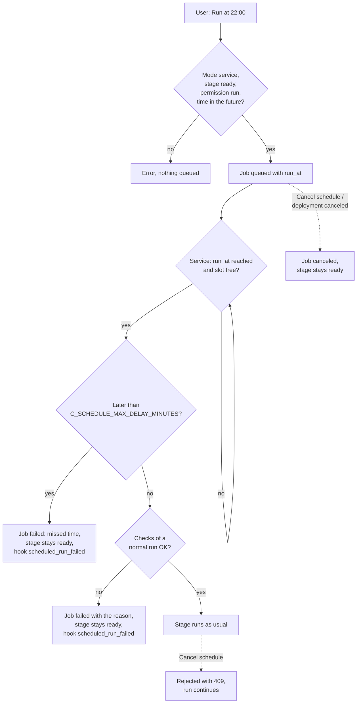

# Run a stage at a scheduled date/time

- **Status:** finished (2026-11-23; tested with `tests/test_scheduled_stage_run.py`, `tests/test_web_scheduled_run.py`, `tests/test_web_browser_schedule.py` and in headless Chrome, not on IBM i)
- **Type:** feature
- **Priority:** P3

## Current situation

A stage starts when a user clicks `Run` (or calls the Web API), or right after the previous stage if it has `run_immediate`.
To deploy outside business hours (e.g. `PROD` at 22:00), someone has to be online at that time.

In mode `service` a run is a job in the queue (`processing_jobs`). The service takes the oldest `queued` job (`claim_next_job()`, `ORDER BY id`) as soon as a slot is free.

## Requirements

1. A user can schedule the run of a stage for a date and time, instead of running it now: where `Run` is possible (a `ready` stage, or a `failed` one to run it again).
   On the deployment page: `Run at…` next to `Run` (with `Continue` / `Run all` as for `Run`). In the Web API: an optional `run_at` for the run of a stage.
2. The run is a job in the queue of the processing service. The service doesn't take it before its time.
3. Only in mode `service`. In mode `thread` the option isn't shown, and the Web API rejects `run_at` (`409`).
4. The user enters the time in the time zone of their browser. Until it has started, the scheduled run is shown on the stage (`scheduled 2026-11-24 22:00 CET`, user)
   and on `Settings` → `Processing` (jobs), in the time zone of the viewer's browser.
5. A scheduled run can be canceled as long as it hasn't started: button `Cancel schedule` on the stage, and in the Web API `POST /api/cancel_job/{job_id}`.
   Every user with the permission `run` for the stage may cancel it, not only the one who scheduled it.
   Once the service has taken the job, it can't be canceled anymore (`409`, as for a queued job). The stage stays `ready` after the cancel.
   To change the time: cancel it and schedule it again.
6. While a run is scheduled, the deployment is blocked like with a queued job: no other stage of the deployment can be started (unless `parallel_deployment_execution_allowed`),
   and the processing mode can't be switched to `thread`. To do something else first, cancel the schedule.
7. A run which is taken by the service more than `C_SCHEDULE_MAX_DELAY_MINUTES` after its time is not run (missed time):
   the job is `failed` with `Missed the scheduled time (<time>)`, the stage stays `ready`. So a night deployment doesn't start during business hours,
   e.g. because the service wasn't running at the time or all slots (`C_SERVICE_MAX_PARALLEL_JOBS`) were busy.
8. At its time the run is checked again like a normal run (status of the stage and the deployment, older deployments of the project, other stages running).
   If it can't run, the job is `failed` with the reason, the stage stays `ready`.
9. In both cases (7, 8) the new hook `scheduled_run_failed` is called, so someone can be informed (e.g. by mail). `stage_failed` is not called: the stage hasn't run.
10. The run is done in the name of the user who scheduled it, and recorded in the history with the time it was scheduled for.
11. Canceling the deployment removes the scheduled run (as for queued jobs).

## Acceptance criteria

- [x] Test: a job with `run_at` in the future is not claimed. Once `run_at` is reached it is.
- [x] Test: a normal job queued after a scheduled one is still run immediately (the scheduled one doesn't block the queue).
- [x] Test: mode `thread` → `run_at` is rejected with `409`.
- [x] Test: `run_at` in the past, not a valid date or without time zone offset → `422` (the status of invalid input in this app, see [webapi.md](../webapi.md#responses-and-errors)).
- [x] Test: `run_at` with an offset other than the server's (e.g. `+09:00`) is run at the right moment.
- [x] Test: a stage which can't be run can't be scheduled (e.g. while another run is scheduled).
- [x] Test: users without `run` for the stage get `403` (schedule and cancel).
- [x] Test: another user with `run` can cancel the scheduled run.
- [x] Test: canceling the scheduled job before its time → job `canceled`, stage stays `ready`, the service doesn't run it at its time.
- [x] Test: canceling the deployment removes the scheduled job from the queue.
- [x] Test: canceling a scheduled job which is already running → `409`, the run continues.
- [x] Test: after a cancel the stage can be scheduled again or run immediately.
- [x] Test: while a run is scheduled, another stage of the deployment can't be started (`409`), and the mode can't be switched to `thread`.
- [x] Test: a job taken later than `C_SCHEDULE_MAX_DELAY_MINUTES` after its time → `failed` with `Missed the scheduled time`, stage `ready`, hook `scheduled_run_failed` called, no step run.
- [x] Test: at its time the stage isn't runnable anymore → job `failed` with the reason, stage stays `ready`, hook `scheduled_run_failed` called, `stage_failed` not called.
- [x] Test: the run is recorded with the user who scheduled it.
- [x] Test (browser): `Run at…` on the deployment page, the scheduled run shown on the stage in the browser's time zone, `Cancel schedule`.
- [x] Docs: [processing-service.md](../processing-service.md#scheduled-runs), [concepts.md](../concepts.md#running-a-stage), [workflow.md](../workflow.md#hooks) (new hook), [webapi.md](../webapi.md#run-a-stage), [permissions.md](../permissions.md#permissions), [glossar.md](../glossar.md) (scheduled run, UTC, DST, ISO 8601).
  The data model is described in [processing-service.md](../processing-service.md#scheduled-runs) (`docs/datenmodell.md` doesn't exist).

Tests: `tests/test_scheduled_stage_run.py` (queue, job process, service, database update), `tests/test_web_scheduled_run.py` (Web API, permissions, page, a real service),
`tests/test_web_browser_schedule.py` (browser, time zone `Asia/Tokyo`).

## Non-goals

* Scheduling a single processing step (the stage stopping and waiting before a step)
* Recurring runs (every night, cron)
* Time windows in the workflow file (e.g. `PROD` only between 22:00 and 06:00)
* Scheduled runs in mode `thread`
* Scheduling a stage which isn't `ready` yet (e.g. `PROD` while `TEST` is still running)
* Changing the time of a scheduled run (cancel and schedule again instead)

## Decisions (2026-11-23)

* **What:** the run of a stage. Not single processing steps.
* **Who sets the time:** the user, per deployment (web app and Web API). Not the workflow file.
* **Mode:** only `service`. The service survives a restart of the web app, so the run doesn't depend on it.
* **Cancel:** possible until the run has started, by every user with `run` for the stage. Reuses `POST /api/cancel_job/{job_id}`:
  it only cancels jobs which are still `queued`, atomically, so a job the service has just taken can't be canceled by mistake.
* **Blocking:** a scheduled job is an active job like a queued one (same rules, no special case).
* **Missed time:** new setting `C_SCHEDULE_MAX_DELAY_MINUTES` in `etc/constants.py` (default `60`), can be overridden in `etc/settings.py`.
  The delay is measured when the service takes the job.
* **Hook:** new event `scheduled_run_failed` with the usual signature `(event, meta_file, stage_obj)`, so existing hook functions (e.g. `jira.on_event`) can be used for it.
  The reason is the `error` of the job: the last job of the stage (`processing_job_data`). It runs in the service, like the other hooks of a run.
* **Time zone:** the user enters the time of their browser. The browser sends it as ISO 8601 with offset (`2026-11-24T22:00:00+01:00`).
  The Web API requires the offset (`422` without), so a time is never interpreted in the wrong zone.
  `run_at` is stored in UTC and compared with the current time in UTC: independent of the zone of the server and of the change to/from daylight saving time.
  The pages show it converted to the viewer's browser time with the name of the zone.
* **Four-eyes check:** if a stage needs an approval (feature [four-eyes check](four-eyes-check.md), not implemented yet), it has to exist when the run is scheduled.
  Approve during the day, deploy at night. Noted there.
* **Implementation:** new column `run_at` in `processing_jobs` (database version 8, `modules/db/updates/v_4_1_0.py`).
  It's stored as `2026-11-24T21:00:00+00:00`, always UTC and to the second, so SQLite compares it as text.
  `claim_next_job()` only takes jobs with `run_at IS NULL OR run_at <= now`. The service already looks into the queue every `C_SERVICE_POLL_INTERVAL` seconds,
  so the run starts at most that late. No new package.

## Decisions during the implementation (2026-11-23)

* **Which stages:** where `Run` is possible, so also a `failed` stage (to run it again at night). Same checks as `Run` (`check_deployment_ready_2_run`).
* **Invalid `run_at`:** status `422`, like all invalid input of the Web API (the draft said `400`).
* **At its time** (`processing_service.start_scheduled_run`): the job process checks the delay, then the stage, and claims it (`in process`) before it's run.
  So a failed check never touches the stage, and a check which passes can't be overtaken by another start.
* **Error texts** don't contain the time: the page shows it in the time zone of the browser, the hook finds it in `run_at` of the job.
  `Missed the scheduled time by <n> minutes (limit C_SCHEDULE_MAX_DELAY_MINUTES = 60) ...` or `The stage could not be run: <reason>`.
* **`C_SCHEDULE_MAX_DELAY_MINUTES = 0`:** no limit (like `C_COMMAND_TIMEOUT_SECONDS = 0`).
* **History** (`Action_type`): `schedule_stage` (time, job, continue / all steps), `cancel_schedule`, `scheduled_run_failed` (time, job, reason),
  and `run_stage` of the scheduled run with `Scheduled run for <time> (job <id>)`.
* **Deployment page:** stage state `scheduled` (status view: kind `queued`, icon `calendar-event`) while the job waits for its time, `queued` after that until the service takes it.
  Attention bar `Stage PROD runs at <time>, scheduled by <user>.` with `Cancel schedule`. A scheduled run which didn't start is shown as danger
  (`The scheduled run of PROD at <time> did not start. <reason>`) until the stage changes or a new job is queued.
* **Times in the browser's time zone:** the server renders `<time datetime="...UTC..." data-local-time>` with the UTC time as text (macro `local_time`, filter `utc`).
  `static/assets/js/app/time.js` (loaded by `components.js` on every page) replaces the text, also in parts loaded later (MutationObserver).
  The dialog `Run at…` uses `<input type="datetime-local">` and sends the time with the offset of the browser at that date.
* **Settings → Processing:** column `Scheduled for` in the jobs table, a waiting scheduled job has the pill `scheduled`.

## Open questions

None.
