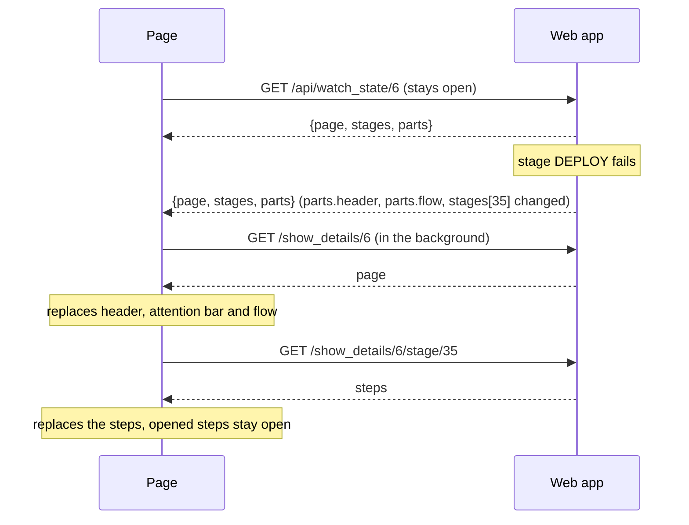

# Deployment page: updates without reloading the page

- **Status:** finished (2026-11-19; tested with `tests/test_live_updates.py`, `tests/test_web_browser_live.py` and in headless Chrome, not on IBM i)
- **Type:** improvement
- **Priority:** P2
- **Source:** [Modernization of the web front end](web-ui-modernization.md), step 5
- **Depends on:** [Deployment page](web-ui-deployment-page.md)

## Current situation

* `/api/watch_state/{meta_file_id}` sends a hash of the page (`page`) and one per stage (`stages`) whenever something changes ([auto refresh](auto-refresh.md), [performance](performance-blocking-handlers.md)). The OBI extension uses the same endpoint.
* If `page` changes (status of the deployment, a stage, a job, an object, a new run), the page calls `location.reload()` ([show-deployment.html:644](../../webapp/templates/overview/show-deployment.html#L644)).
  While a stage runs, that happens again and again: filters, the page of the objects table, the scroll position and opened details are lost each time, and all files are asked for again.
* If a dialog is open, the reload waits until it's closed.
* Only the steps popup is updated in place.
* After an error of the connection (restart of the web app, network) the page closes it and never connects again ([show-deployment.html:661](../../webapp/templates/overview/show-deployment.html#L661)). Nothing shows that the page is not current any more.

## Feature

* The signature gets a third key `parts` with one hash each for `header` (status of the deployment, jobs), `flow` (stages, jobs), `objects` and `activity`. `page` and `stages` stay as they are (OBI extension).
* The parts of the page are marked (`data-part="header"`, `attention`, `flow`, `activity`). If the hash of a part changes, the script loads the page in the background and replaces only the changed parts. At most one load per second.
* `objects`: the table is refreshed with its data (`refresh` of bootstrap-table, silent), so sorting, filters and the page stay.
* Steps of the selected stage: loaded again if `stages[id]` changes. Opened steps and sub-steps stay open (by their id).
* The title of the tab follows the status (`erp 6 · failed · i-Releaser`).
* Nothing is reloaded with `location.reload()`. Open dialogs stay open.
* **Connection:** if it ends, the script connects again after 2, 5, 10 and then every 30 seconds. Meanwhile the header shows `Reconnecting ...`. After the connection is back, all parts are loaded once.
* **Session:** if a background load is answered with `401`, the page shows `Your session has ended` (see [scripts](web-ui-scripts.md)) and stops.
* A hidden tab closes the connection, as today. When it's shown again, it connects and loads all parts once.

## Acceptance criteria

- [x] Test: the signature contains `page`, `stages` and `parts`. `parts.objects` only changes with an object, `parts.flow` with a stage or job, `parts.activity` with a new entry; `page` and `stages` as before.
- [x] Browser tests (or manual checks, see [browser tests](web-ui-browser-tests.md)):
  * run a stage: its status, the attention bar and the steps change while the page is **not** loaded again (a value set in `window` before is still there);
  * a filter of the objects table, its page, the scroll position and an opened step survive a change;
  * an open log dialog stays open during a change;
  * stop and start the web app: `Reconnecting ...` is shown, then the page is current again, including what changed meanwhile;
  * an ended session shows the message.
- [x] Measurement: 10 open pages without changes cause no more database load than today (0.11 ms per check, see [performance](performance-blocking-handlers.md#measurements)). Numbers in this file: the marker check costs 0.020 ms of SQL instead of 0.009 ms (+0.011 ms), about 0.12 ms per check with the connection instead of 0.11 ms (20 stages, 60 steps, 2026-11-19). The small increase is needed: a step which starts changes only its own row (see Implementation). 10 open pages: still about 0.006 % of a core.
- [x] Docs: [webapi.md](../webapi.md) (`watch_state`).

## Implementation (2026-11-19)

* `Meta_File.get_state_signature` has `parts`: `header` (status, update time, jobs, custom data), `flow` (status of the stages, jobs), `objects` (status and `ready` of the objects), `activity` (runs, last entry of the processing history). `page` and `stages` are unchanged.
* `meta_file_data.get_state_marker` also counts the running steps of the deployment and reads the last entry of its processing history: since the [running step](../bugfixes/running-step-status-not-stored.md) fix a step which starts changes only its own row. Sub-steps which start are shown when they end (or with the next change).
* The page (`pages/deployment.js`) loads itself in the background (`GET /show_details/{id}`, at most once a second) and replaces the parts `header`, `details`, `attention`, `flow`, `activity` which changed (`data-part`). The attention bar is also replaced when a stage changes (it says which step runs). Kept: the open custom data, the tab of the activity, the selected stage.
* The objects: `GET /api/deployment_objects/{id}` and `load` of bootstrap-table, on the same page of the table; the filters stay. The number of objects in the title follows.
* The steps panel: loaded again when its stage changes, or the header or the flow (its buttons depend on the deployment). Open steps, folded rows, filter and scroll position stay.
* After an action (run, reset, cancel, custom data) the page shows a toast and loads all parts once: no `location.reload()` any more.
* Connection lost: `Reconnecting …` above the page, new tries after 2, 5, 10 and then every 30 seconds; each try first loads a part of the page, so an ended session (`401`) shows `Your session has ended` and stops the updates. After the connection is back, all parts are loaded once.

## Non-goals

* Live updates of the lists, the settings and the jobs of the processing service
* WebSockets
* Notifications of the browser when a stage has finished

## Open questions

None. The [deployment page](web-ui-deployment-page.md#decisions-2026-11-19) is finished; its auto refresh (reload of the page when `page` changes, steps panel in place) is what this step replaces.
