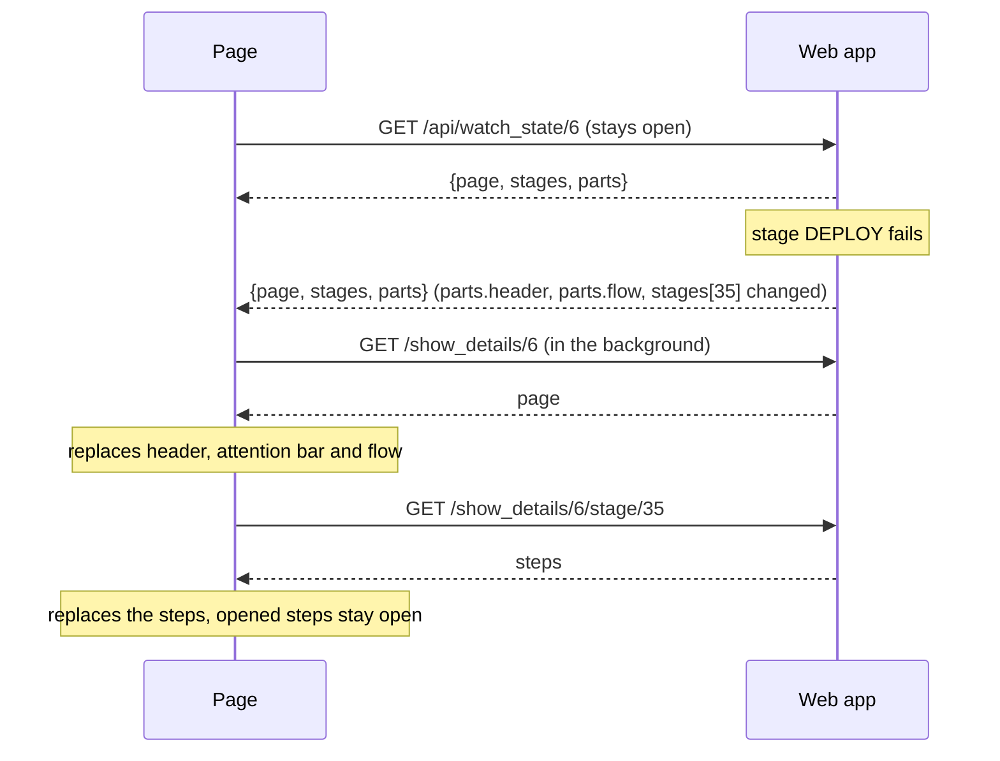

# Deployment page: updates without reloading the page

- **Status:** draft
- **Type:** improvement
- **Priority:** P2
- **Source:** [Modernization of the web front end](web-ui-modernization.md), step 5
- **Depends on:** [Deployment page](web-ui-deployment-page.md)

## Current situation

* `/api/watch_state/{meta_file_id}` sends a hash of the page (`page`) and one per stage (`stages`) whenever something changes ([auto refresh](auto-refresh.md), [performance](performance-blocking-handlers.md)). The OBI extension uses the same endpoint.
* If `page` changes (status of the deployment, a stage, a job, an object, a new run), the page calls `location.reload()` ([show-deployment.html:644](../../webapp/templates/overview/show-deployment.html#L644)).
  While a stage runs, that happens again and again: filters, the page of the objects table, the scroll position and opened details are lost each time, and all files are asked for again.
* If a dialog is open, the reload waits until it's closed.
* Only the steps popup is updated in place.
* After an error of the connection (restart of the web app, network) the page closes it and never connects again ([show-deployment.html:661](../../webapp/templates/overview/show-deployment.html#L661)). Nothing shows that the page is not current any more.

## Feature

* The signature gets a third key `parts` with one hash each for `header` (status of the deployment, jobs), `flow` (stages, jobs), `objects` and `activity`. `page` and `stages` stay as they are (OBI extension).
* The parts of the page are marked (`data-part="header"`, `attention`, `flow`, `activity`). If the hash of a part changes, the script loads the page in the background and replaces only the changed parts. At most one load per second.
* `objects`: the table is refreshed with its data (`refresh` of bootstrap-table, silent), so sorting, filters and the page stay.
* Steps of the selected stage: loaded again if `stages[id]` changes. Opened steps and sub-steps stay open (by their id).
* The title of the tab follows the status (`erp 6 · failed · i-Releaser`).
* Nothing is reloaded with `location.reload()`. Open dialogs stay open.
* **Connection:** if it ends, the script connects again after 2, 5, 10 and then every 30 seconds. Meanwhile the header shows `Reconnecting ...`. After the connection is back, all parts are loaded once.
* **Session:** if a background load is answered with `401`, the page shows `Your session has ended` (see [scripts](web-ui-scripts.md)) and stops.
* A hidden tab closes the connection, as today. When it's shown again, it connects and loads all parts once.

## Acceptance criteria

- [ ] Test: the signature contains `page`, `stages` and `parts`. `parts.objects` only changes with an object, `parts.flow` with a stage or job, `parts.activity` with a new entry; `page` and `stages` as before.
- [ ] Browser tests (or manual checks, see [browser tests](web-ui-browser-tests.md)):
  * run a stage: its status, the attention bar and the steps change while the page is **not** loaded again (a value set in `window` before is still there);
  * a filter of the objects table, its page, the scroll position and an opened step survive a change;
  * an open log dialog stays open during a change;
  * stop and start the web app: `Reconnecting ...` is shown, then the page is current again, including what changed meanwhile;
  * an ended session shows the message.
- [ ] Measurement: 10 open pages without changes cause no more database load than today (0.11 ms per check, see [performance](performance-blocking-handlers.md#measurements)). Numbers in this file.
- [ ] Docs: [webapi.md](../webapi.md) (`watch_state`).

## Non-goals

* Live updates of the lists, the settings and the jobs of the processing service
* WebSockets
* Notifications of the browser when a stage has finished

## Open questions

None of its own. It waits for the decisions of the [deployment page](web-ui-deployment-page.md#open-questions).
