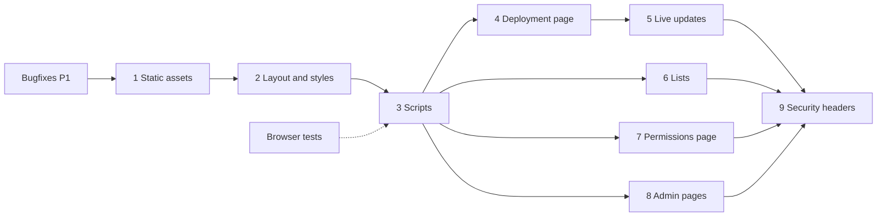

# Modernization of the web front end

- **Status:** draft
- **Type:** improvement
- **Priority:** P2
- **Source:** User request 2026-11-16 (like the UI refresh of the OBI extension)

Analysis of the web front end, the answer to "complete redesign?", and the plan. Each step has its own file, see [steps](#steps).

## Result in short

* **Yes, a redesign of the front end:** new layout, new styles, every page laid out again, scripts moved out of the templates. Step by step, the app stays usable after each step (as in the OBI extension).
* **No rewrite of the technology:** the pages stay Jinja2 templates rendered by FastAPI. No single-page app, no Node build.
  * The problems below don't come from server rendering. They come from scripts, styles and HTML which grew inside the templates.
  * A single-page app (as tried in `react-ireleaser`, Next.js, last change 2025-02) needs a build chain with Node, many new packages to review, and login, permissions and every page a second time. [architektur.md](../architektur.md) asks for Jinja2 templates, and i-Releaser has to be installable on IBM i with Python only.
* **The server stays as it is.** The Web API and the URLs used from outside don't change (the OBI extension uses `/api/...` and `/show_details/{id}`). A few additions are listed in the steps.
* **Six defects were found on the way,** three of them should be fixed before the redesign, see [defects](#defects-found).

## How it was analysed

* All templates, scripts, styles, routes and the middleware were read.
* The web app was run on a copy with test data (`tests/web_server.py`: three workflows, a failed deployment with objects, parallel stages) and opened in Chrome: every page at 1440 px, the deployment page and the list at 420 px.
* Suspected defects were reproduced there. "Code review" marks what was only found in the code.

## Current situation

| Area | Finding |
|---|---|
| Scripts | 1,528 lines of JavaScript inside 6 templates (866 in `show-deployment.html`, 478 in `settings.html`). 49 inline handlers (`onclick="..."`): 43 in templates, 6 in Python strings. Python builds HTML and JavaScript as text (`flowchart.py`), JavaScript builds HTML as text. `web.deploy.js` has five copies of the same `fetch` call. |
| Styles | 276 lines of CSS inside templates. Layout with nested tables (up to 4 levels on the permissions page), `&nbsp;` and ` ` (on 45 lines). |
| Files | `webapp/static` has 35 MB, most of it unused: Font Awesome 22 MB for 3 icons, 2.6 MB of fonts, `rist.css` with 11,335 lines, 3 more stylesheets, 2 scripts, 4 images. See [static assets](web-ui-static-assets.md). |
| Libraries | Loaded in three ways (local, CDN, a redirecting dead CDN). bootstrap-table in two versions, jQuery and Popper twice, SweetAlert2 twice on some pages. Three kinds of icons: Bootstrap Icons, Font Awesome, 6 PNG files used as buttons. |
| Status | A status is a coloured button. Some do something hidden (the status of a deployment reloads the page; the status in the list is the only link to the deployment), most do nothing. The mapping status → colour exists 7 times. |
| Navigation | Not collapsible ([architektur.md](../architektur.md#gui) asks for it). The active entry comes from the parameter `?sidebar_active=`, the project of the list from the session: a URL can't be shared. Detail pages have a `Back to overview` button. No page titles. |
| Deployment page | The steps of a stage are a popup with nested tables, wider than the screen. A log replaces the popup, which is opened again afterwards. Actions need 2 – 3 dialogs (`Are you sure?` → `Canceled!` → reload). Small PNG icons without text start, reset and cancel. |
| Auto refresh | Every change reloads the whole page: filters, the page of the table, the scroll position and opened details are lost. After a connection error it stops for good. |
| Tables | Column names of the database as headings (`meta_file_id`, `latest_create_time`). Jobs, history, steps and keys are plain tables ([architektur.md](../architektur.md#gui): bootstrap-table with sorting, filters, paging). |
| Texts | English with German words (`Projekt`), `None` for empty values, times with microseconds, `No, ups!`. |
| Small screens | Not usable at 420 px. At 1440 px the deployment page is 254 px wider than the window. |
| Dark mode | None. |
| Security | No Content-Security-Policy and no other security headers. See also [defects](#defects-found). |
| Tests | No test runs JavaScript. All defects below were only visible in a browser. |
| Customising | `custom_templates/deployment_status.html` and `custom/routes` depend on the block names of `base.html`, on global functions (`postData`, `Swal`) and on paths of images. Nothing of that is documented as a contract. |

## Defects found

| Priority | Defect | Type | Fix |
|---|---|---|---|
| P1 | [Scripts from third-party servers](../bugfixes/web-scripts-from-third-party-servers.md) | security | finished 2026-11-17 |
| P1 | [Values can run as script (XSS)](../bugfixes/web-values-run-as-script.md) | security | finished 2026-11-17 |
| P1 | [Permissions page: can't save, or removes permissions](../bugfixes/permissions-page-names-in-selectors.md) | bug (data loss) | finished 2026-11-17 |
| P2 | [A stage name can turn off all buttons of the deployment page](../bugfixes/stage-name-breaks-deployment-page.md) | bug | finished 2026-11-17 |
| P2 | [Objects table of the deployment page](../bugfixes/deployment-objects-table.md) | bug | with step 4, or before |
| P3 | [Minor defects of the web pages](../bugfixes/minor-web-defects.md) | bug | with the steps |

## Target

1. **Templates:** one base layout; repeated parts are macros (status, page header, icon button, empty state). No tables for layout.
2. **Styles:** one stylesheet of the app with design tokens (CSS variables) for colours, spacing and fonts, light and dark, on top of Bootstrap 5.3.
3. **Icons:** one set (Bootstrap Icons).
4. **Scripts:** only in files (`static/assets/js/`, ES modules, no build step). Data for a script comes from `data-*` attributes or a JSON block. No inline scripts, no `on...=`.
5. **Files:** everything local, each library once, with a fixed version.
6. **Content-Security-Policy:** makes 4 and 5 a rule the browser enforces.
7. **Status:** shown the same way everywhere, with colour, icon and text. One mapping.
8. **Actions:** the main action of a page is a button with text. Actions which can't be undone ask once. The result is a short message, not a second dialog.
9. **Updates in place:** a change updates the parts of the page it affects.
10. **Tables:** bootstrap-table with sorting, filters and paging for lists; lists of key and value for details.
11. **URLs:** a URL describes the page. The navigation knows the active entry without a parameter.
12. **Customising:** `custom_templates` and `custom/routes` keep working, with a documented contract.

## Steps

| Step | File | Size | Status |
|---|---|---|---|
| – | The three P1 bugfixes above | S each | finished |
| 1 | [Static assets: local, pinned, cleaned up](web-ui-static-assets.md) | S | ready |
| 2 | [Layout and styles](web-ui-layout.md): base layout, navigation, design tokens, components, login and error page | L | draft |
| 3 | [Scripts in files](web-ui-scripts.md): modules, shared helpers, rules, contract for custom templates | M | draft |
| 4 | [Deployment page](web-ui-deployment-page.md): header, stage flow, steps, objects, logs | L | draft |
| 5 | [Live updates](web-ui-live-updates.md): no reload of the page | M | draft |
| 6 | [Lists](web-ui-lists.md): deployments, objects, start of a workflow | M | draft |
| 7 | [Permissions page](web-ui-permissions-page.md) | M | draft |
| 8 | [Admin pages](web-ui-admin-pages.md): settings, logs, workflows, user | M | draft |
| 9 | [Security headers](web-ui-security-headers.md): Content-Security-Policy | S | draft |
| – | [Browser tests](web-ui-browser-tests.md) (new package) | M | draft |

Steps 4, 6, 7 and 8 are independent of each other. Pages which are not done yet keep working in the new layout, with their old scripts.

## Done when

- [ ] All steps are `finished`.
- [ ] The screenshots of [README.md](../../README.md) are new (`deployment`, `workflow-list`, `parallel`, `details`, `history`, `history-detail`, `object-list`, `http-token`, `rollback-started`, `rollback` in `docs/img/`).
- [ ] [architektur.md](../architektur.md#gui) contains the decisions of this file (see below).
- [ ] Changelog entry, with what owners of custom templates have to do before the update.

## Proposed changes of architektur.md

After the decisions below, the section `GUI` gets these rules (today's rules stay):

* Scripts only in files. No inline scripts, no `on...=` attributes, no values inside JavaScript in templates.
* No HTML built from data as text, neither in Python nor in JavaScript.
* All files local. Libraries pinned and listed in [technik.md](../technik.md#package-prüfung).
* Colours, spacing and fonts only from the tokens of `app.css`. A status is shown with the macro `status_pill`.
* Icons: Bootstrap Icons.
* SweetAlert2 for confirmations and small inputs. Larger content (logs, steps) is part of the page or a panel.

## Non-goals

* A single-page app or another template engine
* Changes of the Web API for other clients, of the database, or of the processing of stages
* Translations: the web app stays English
* New functions (dashboard, statistics, notifications). Ideas which came up are listed in the steps under `Non-goals`.

## Open questions

They affect all steps. A recommendation is given for each.

1. **Bootstrap:** keep Bootstrap 5.3 as the base and put the own stylesheet on top (**recommended**: bootstrap-table needs it, it's already there, and it has a dark mode), or write all styles new as in the OBI extension?
2. **Mockup first?** For the OBI extension the layout of the configuration page was approved with a mockup. Recommended here as well: one mockup of the deployment page and one of the deployment list, in light and dark, before step 2 starts. The wireframes in the steps show the structure, not the look.
3. **Dark mode:** yes, following the setting of the browser, with a switch (**recommended**)?
4. **Look:** the same language as the i-Releaser card of the OBI extension (status pills, stepper with circles, attention bar), so both look like one product (**recommended**)?
5. **Logo:** the navigation uses `logo2-icon.png`, the login page `logo.png` (two different logos). Which one is the logo of i-Releaser?
6. **Small screens:** [architektur.md](../architektur.md#gui) says "mobile-friendly if possible (low priority)". Proposal: everything works from 768 px; below that the navigation becomes a menu and wide tables scroll inside their box, nothing is optimised further.
7. **Browser tests:** add Playwright as a development package (**recommended**, see [browser tests](web-ui-browser-tests.md))? Without it, each step has a list of manual checks.
8. **Custom templates:** inline scripts and `onclick` in custom templates stop working with step 9. Accept that, with a migration note and an example (**recommended**, see [scripts](web-ui-scripts.md#custom-templates))?
9. **Release:** one branch for all steps and one release, or release after each step (**recommended**: one branch per step, merged when the step is finished)?
