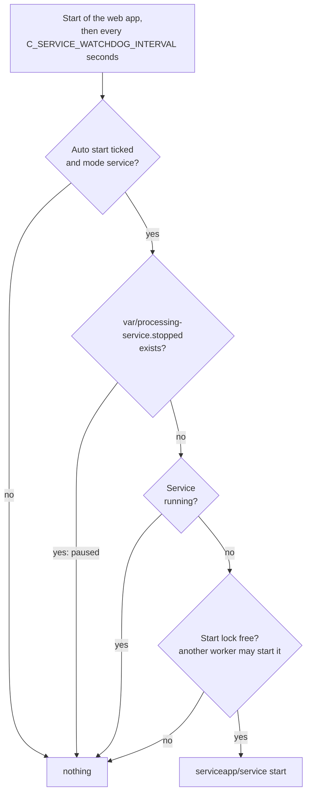

# Processing service

By default a stage is run by the web app: in a thread of the web server job.
If that job ends (restart of the web server, a crashed worker, ...), the stage ends with it and stays in status `in process`.

The processing service is an independent job which runs the stages instead.
The web app only tells it what to run.

* A stage keeps running when the web app ends.
* A stage keeps running when the service is stopped or restarted.
* Each stage runs in its own process. It can't influence the web app or another stage.
* A stage whose process died is set to `failed` automatically, so it can be run again.


## How it works

```
web app                                processing service

Run stage
  1. checks the stage (permission, status)
  2. adds a job to the queue
  3. wakes up the service  ---------->  4. takes the job from the queue
                                        5. starts an own process for it
                                           which runs the stage
shows the progress as usual  <--------  status of stage, steps and logs
```

* The queue is the table `processing_jobs` in the database (`var/app.sqlite`). Web app and service only communicate over the database.
* The wake up (a local socket in `var/`) makes sure the stage starts immediately. If it gets lost, the service finds the job with its next look into the queue (`C_SERVICE_POLL_INTERVAL`).
* The process of a job is a copy of the running service. Python, the modules and the scripts are already loaded, so there is no waiting time.
* A stage is run in the name of the user who started it.
* Following stages which are run automatically (`run_immediate`) are processed by the same job.


## Set up

In the web app (permission `admin`): `Settings` &rarr; `General` &rarr; `Processing of stages`.
Change the mode and start the service there. No restart is necessary.

Or on the command line:

1. Switch the mode in `etc/settings.py` and restart the web app

   ```python
   C_PROCESSING_MODE = 'service'
   ```

2. Start the service

   ```bash
   [andreas@idev i-releaser]$ cd serviceapp
   [andreas@idev serviceapp]$ ./service start
   Start service
   Service is running ...
   ```

   Also available: `./service stop`, `./service status`, `./service restart`

Run the service with the same user as the web app (the web app starts it with its own user).
A service started in the web app keeps running when the web app ends.

The mode changed in the web app is stored in `etc/app.json` and overrides `etc/settings.py`.
The settings page shows where the current mode comes from. Both use the same database, logs and meta directories.
(Earlier versions used `etc/web_settings.json`. The web app renames it at its start.)


### Start automatically

Tick `Start automatically` next to the buttons `Start`, `Stop` and `Restart` (permission `admin`, off by default, stored in `etc/app.json`).
In mode `service` the web app then makes sure the service is running: when it starts and every `C_SERVICE_WATCHDOG_INTERVAL` seconds.
So the service is running again after a restart of the system (as soon as the web app runs) or a crash of the service.



* **Paused after a stop:** `Stop` in the web app or `./service stop` on the command line creates `var/processing-service.stopped`.
  As long as it exists, the service is not started automatically. `Start` and `Restart` remove it. `./service status` shows it.
  So a service you stopped on purpose stays stopped.
* **Only one service:** all workers of the web app check, but only one of them starts the service (lock `var/processing-service.lock.start`).
  The service itself holds `var/processing-service.lock` as long as it runs: a second service ends immediately with `Processing service is already running`.
* **Failed start:** the web app keeps running. The error is in the log of the web app (`Auto start of the processing service failed`)
  and in `log/service_nohup.log` / `log/service.log`. The next check tries again.
* **systemd:** if the web app runs as a systemd unit (`KillMode=control-group`, the default), systemd stops the service together with the web app.
  There run the service as its own unit and leave `Start automatically` off. Not relevant on IBM i.

The current state is shown in the web app: `Settings` &rarr; `General` &rarr; `Processing of stages`.
There you also find the last jobs with their status and error.


## Settings

The defaults are in `etc/constants.py`. Put your values into `etc/settings.py`.

| Setting | Default | Description |
|---|---|---|
| `C_PROCESSING_MODE` | `'thread'` | `'thread'`: stages are run by the web app. `'service'`: stages are run by the processing service. |
| `C_SERVICE_MAX_PARALLEL_JOBS` | `4` | Number of stages which are run at the same time. Further stages wait in the queue. |
| `C_SERVICE_POLL_INTERVAL` | `5` | Seconds between two looks into the queue, if the service was not woken up. Also the time until a died job process is noticed. |
| `C_SERVICE_HEARTBEAT_INTERVAL` | `10` | Seconds between two signs of life of a running job. |
| `C_SERVICE_HEARTBEAT_TIMEOUT` | `60` | Seconds without a sign of life until a job is seen as dead. |
| `C_SERVICE_SOCKET` | `var/processing-service.sock` | Socket for the wake up. |
| `C_APP_SETTINGS_FILE` | `etc/app.json` | Settings changed in the web app: processing mode (overrides `C_PROCESSING_MODE`) and `Start automatically`. |
| `C_SERVICE_WATCHDOG_INTERVAL` | `60` | Seconds between two checks of the web app whether the service is running (only with `Start automatically`). |
| `C_SERVICE_PID_FILE` | `var/processing-service.pid` | Process id of the service. If you change it, also change it in `serviceapp/service`. |
| `C_SERVICE_STOPPED_FILE` | `var/processing-service.stopped` | Exists after a stop: `Start automatically` is paused. If you change it, also change it in `serviceapp/service`. |
| `C_SERVICE_LOCK_FILE` | `var/processing-service.lock` | Locked by the running service, so only one service runs. |

The service doesn't start if the database is older than the code: start the web app first after an update, it updates the database.


## What happens if ...

| Situation | Behaviour |
|---|---|
| The web app is stopped | Running stages continue. |
| The service is stopped | Running stages continue. They are not affected by the restart of the service. |
| The service crashes or the system is restarted | With `Start automatically` the web app starts it again within `C_SERVICE_WATCHDOG_INTERVAL` seconds (after an IPL: as soon as the web app runs). Otherwise start it by hand. |
| The service is started twice at the same time | Only one of them runs, the other one ends with `Processing service is already running`. |
| A stage is started while the service is not running | The stage is added to the queue and you get a warning. The stage shows the button `queued`. It's run as soon as the service has been started. |
| You don't want to wait for the service | Click on `queued` to remove the stage from the queue. |
| A job process dies (killed, restart of the system) | The job, its stage and the deployment are set to `failed`. The hook `stage_failed` is called. The stage can be run again (`Continue processing` starts with the step which was not finished). |
| A stage is started twice | The second start is rejected as long as the first one is queued or running. |
| A deployment is canceled | Its stages are removed from the queue. A stage which is already running is not stopped (same behaviour as without the service). |
| More stages are started than `C_SERVICE_MAX_PARALLEL_JOBS` | They wait in the queue (button `queued`) and start one after another. |


## Good to know

* Steps and scripts run in the same environment as with the web app: the working directory is `webapp/` and the configs of `webapp/etc` are available.
* Scripts are loaded when the service starts. Restart the service after you changed a file in `scripts/` (like you have to restart the web app in mode `thread`).
* [Hooks](workflow.md#hooks) which are triggered by the run of a stage (`stage_started`, `stage_finished`, `stage_failed`, `deployment_finished`) run in the process of the job. The other hooks still run in the web app.
* Logs of the service: `log/service.log` (and `log/service_nohup.log` for errors during the start). The logs of a stage are stored with the deployment as usual.
* Switching back to `'thread'`: stages which are still in the queue are only run by the service. Let the service finish them or remove them from the queue first (the web app doesn't switch while stages are queued).
