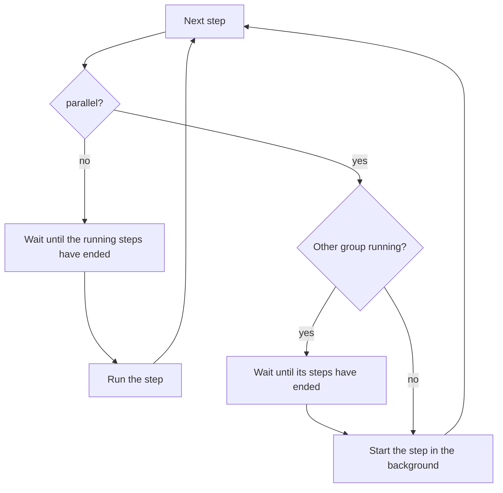

# Workflow configuration

* [Workflow files](#workflow-files)
* [Workflow attributes](#workflow-attributes)
* [Stage attributes](#stage-attributes)
* [Step actions](#step-actions)
* [Commands](#commands)
  * [Placeholders](#placeholders)
* [Object list](#object-list)
* [Object commands](#object-commands)
* [Parallel branches](#parallel-branches)
* [Parallel steps](#parallel-steps)
* [Editable custom fields](#editable-custom-fields)
* [Create fields](#create-fields)
* [Hooks](#hooks)
* [Reset the last finished stage](#reset-the-last-finished-stage)

For the terms (workflow, stage, processing step, ...) see [concepts](concepts.md).


## Workflow files

Each workflow is a JSON file in `etc/workflows/`.

* The files are read again on every access: no restart is needed.
* Each file is checked when it's read. An invalid file is left out, the other workflows keep working. Users with `admin` see it with its error on the page `Workflows`.
* The definition of the workflow is stored with each deployment when it's created. Changes only affect new deployments.
* `etc/workflow.json` with a list of workflows still works, but it's deprecated.

Example with a build, a test and a production stage:

```json
{
  "name": "erp_release",
  "default_project": "erp",
  "editable_fields": ["$.ticket"],
  "hooks": {
    "stage_failed": ["notify.on_failure"]
  },
  "step_action": [
    {"processing_step": "print_pwd", "environment": "PASE", "execute": "pwd", "check_error": true}
  ],
  "stages": [
    {
      "name": "START",
      "next_stages": ["BUILD"],
      "host": "localhost",
      "processing_steps": ["pre", "print_pwd"]
    },
    {
      "name": "BUILD",
      "next_stages": ["TEST"],
      "host": "localhost",
      "build_dir": "/home/build/erp",
      "processing_steps": ["pre", "clean_current_commit", "run_build", "load_object_list"],
      "run_immediate": true
    },
    {
      "name": "TEST",
      "next_stages": ["PROD"],
      "host": "test400",
      "build_dir": "/home/build/erp",
      "remote_dir": "/home/deploy/erp",
      "processing_steps": ["save-prepare", "save", "transfer", "target-prepare", "backup-old-objects", "perform-deployment"],
      "execute_remote": true
    },
    {
      "name": "PROD",
      "next_stages": ["END"],
      "host": "prod400",
      "build_dir": "/home/build/erp",
      "remote_dir": "/home/deploy/erp",
      "processing_steps": ["save-prepare", "save", "transfer", "target-prepare", "backup-old-objects", "perform-deployment"],
      "execute_remote": true
    },
    {
      "name": "END",
      "description": "Finished"
    }
  ]
}
```


## Workflow attributes

| Attribute | Required | Description |
|---|---|---|
| `name` | yes | Unique name of the workflow, over all projects. Not case sensitive. |
| `default_project` | yes | Project of its deployments. Deployments of a project share the version numbers. |
| `stages` | yes | List of [stages](#stage-attributes). One of them has to be named `START`: it's the first stage. |
| `step_action` | no | [Step actions](#step-actions) of this workflow. They replace the entries of `etc/default_step_action.json` with the same `processing_step`. |
| `parallel_deployment_execution_allowed` | no | `true`: deployments of the project don't have to wait for older ones, and stages of a deployment may run at the same time. Default `false` (see [concepts](concepts.md#one-deployment-after-the-other)). |
| `editable_fields` | no | JSONPaths of the custom data which users may edit, see [below](#editable-custom-fields) |
| `create_fields` | no | JSONPaths of the custom data which may be set when a deployment is created, see [below](#create-fields) |
| `hooks` | no | Python functions to call on events, see [below](#hooks) |

Other attributes are rejected.


## Stage attributes

| Attribute | Description |
|---|---|
| `name` | Name of the stage, unique in the workflow (required) |
| `description` | Text shown in the web app |
| `next_stages` | Names of the stages which become `ready` when this one is finished. More than one starts [parallel branches](#parallel-branches). |
| `after_stages_finished` | Names of stages which have to be finished before this stage can be run |
| `run_immediate` | `true`: run this stage automatically as soon as it becomes ready |
| `processing_steps` | Processing steps in the order they are run. Each one needs a [step action](#step-actions). A stage without steps (e.g. `END`) finishes automatically as soon as it's reached and doesn't wait for other stages. |
| `host` | Target system: used by `ssh` for remote `QSYS` commands, by the transfer script, and to find the DB connection of the DB deployment |
| `execute_remote` | `true`: `QSYS` commands run on `host` via SSH. A step action can overwrite it. `PASE` commands always run locally. |
| `build_dir` | Working directory of the commands, and the directory (git repository) the build scripts work in |
| `remote_dir` | Directory on the target system (transfer script) |
| `clear_files` | Used by the example save and backup scripts |
| `lib_replacement_necessary`, `lib_mapping` | Restore into other libraries than the production library, `{"prodlib": "testlib"}` (example script `target_deployment.py`) |


## Step actions

A step action maps a processing step to its command:

* `etc/default_step_action.json`: for all workflows
* `step_action` of a workflow: only for this workflow, replaces default entries with the same `processing_step`

```json
[
  {"processing_step": "pre", "environment": "SCRIPT", "execute": "pre.pre_cmd", "check_error": true},
  {"processing_step": "save", "environment": "SCRIPT", "execute": "save_objects.save_objects_to_savf", "check_error": true},
  {"processing_step": "list_dir", "environment": "PASE", "execute": "ls -la", "check_error": false},
  {"processing_step": "crtlib", "environment": "QSYS", "execute": "CRTLIB {meta_file[deploy_libs][main_lib]}", "execute_remote": true}
]
```

| Attribute | Description |
|---|---|
| `processing_step` | Name used in `processing_steps` of a stage |
| `environment` | `QSYS`, `PASE` or `SCRIPT`, see [commands](#commands) |
| `execute` | The command |
| `check_error` | `true` (default): the stage stops if the step fails. `false`: the stage continues. |
| `execute_remote` | `true`/`false`: overwrites `execute_remote` of the stage for this step (`QSYS` only) |
| `fail_on_stderr` | `false`: only the exit code decides if a `PASE` or `QSYS` step failed. stderr is still stored. Default `true`. |
| `timeout_seconds` | The command and its child processes are ended after this time and the step fails. Default: `C_COMMAND_TIMEOUT_SECONDS` in the [settings](installation.md#configuration-files), 0 means no timeout. A `SCRIPT` step can't be ended. |
| `parallel_group` | Name of the group, in which the step runs at the same time as other steps, see [parallel steps](#parallel-steps) |
| `parallel` | `true`: the step runs at the same time as the steps of its group. Default `false`: the step waits until they have ended. |

The template `etc/examples/default_step_action.json` contains the steps of the [example scripts](scripts.md#example-scripts).


## Commands

| Type | `execute` | How it's run |
|---|---|---|
| `QSYS` | An IBM i command, e.g. `CRTLIB MYLIB` | With `cl -v` in bash, followed by `DSPJOBLOG` (the job log is part of the output, the exit code is the one of the command). With `execute_remote`: `ssh -o BatchMode=yes <host> ...` (so it fails instead of asking for a password). The command reaches `cl` unchanged: `$`, quotes and the like don't need to be escaped. |
| `PASE` | A shell command, e.g. `scp -rp ...` | With `/bin/bash`, in the `build_dir` of the stage |
| `SCRIPT` | `filename.function_name` of a file in `scripts/`, e.g. `pre.pre_cmd` runs `pre_cmd` of `scripts/pre.py` | Called with `(meta_file, stage, action)`, see [scripts](scripts.md) |

A `QSYS` or `PASE` step fails if its exit code isn't 0 **or** if it writes anything to stderr (see `fail_on_stderr`).
Output which isn't UTF-8 is stored with replacement characters.

### Placeholders

These placeholders are replaced in commands. All other braces stay as they are, e.g. `awk '{print $1}'` or `${HOME}`.

| Placeholder | Value |
|---|---|
| `{stage}` | Name of the stage |
| `{processing_step}` | Name of the processing step |
| `{meta_file[general][project]}` | Project |
| `{meta_file[general][deploy_version]}` | Version of the deployment |
| `{meta_file[general][release_branch]}` | Release branch, e.g. `erp-42` |
| `{meta_file[general][commit]}` | Commit given when the deployment was created |
| `{meta_file[general][meta_dir]}` | Directory of the deployment's files |
| `{meta_file[deploy_libs][main_lib]}`, `[backup_lib]`, `[remote_lib]` | [Libraries](concepts.md#libraries-and-branches-of-a-deployment) of the deployment |
| `{meta_file[custom_data][...]}` | A value of the custom data, e.g. `{meta_file[custom_data][ticket]}` |

* Write `{{` and `}}` if you need the literal text of a placeholder.
* A placeholder which doesn't exist (e.g. a custom data field which isn't set) fails the step.
* Values can't change a command:
  * `PASE`: values are quoted for the shell, also inside of `'...'` and `"..."`. They always arrive as one piece of text.
  * `QSYS`: values from users (custom data, commit, object list) may only contain letters, digits and `$ # @ _ . / -`. Otherwise the step fails.


## Object list

The objects of a deployment are imported from a text file, one object per line:

```
{level}|{production library}|{development library}|{name}|{type}|{attribute}
1|prodlib|devlib|orders|file|pf
2|prodlib|devlib|date|srvpgm|sqlrpgle
```

* The file is imported by the step `load_object_list` (`build.load_object_list`): either the file given when the deployment was created (`obj_list` of [create_deployment](webapi.md#create-a-deployment)), or `build-output/object-list.txt` in the `build_dir` of the stage (`C_OBJECT_LIST` in `etc/constants.py`).
* A file given to the Web API has to be in the `build_dir` of a stage of the workflow, or in a directory of `C_OBJECT_LIST_DIRS` in the [settings](installation.md#configuration-files).
* If it's imported again (e.g. the stage is run again), it replaces the objects.
* Names are converted to lower case.
* Users can include or exclude objects on the deployment page (object list).


## Object commands

`etc/object_commands.json` defines additional commands for specific objects.
They are added to the stages which aren't finished when the object list is imported, right after the step with the same `processing_step`.
Each one is shown as its own step, with status and log.

```json
[
  {
    "lib": "prodlib",
    "name": "orders",
    "type": "file",
    "actions": [
      {"processing_step": "post", "environment": "QSYS", "cmd": "CHGPF FILE(PRODLIB/ORDERS) SIZE(*NOMAX)", "stages": ["PROD"], "check_error": true}
    ]
  }
]
```

* `lib`, `name`, `type`: production library, name and type of the object (not case sensitive)
* `actions`: like [step actions](#step-actions), with `cmd` instead of `execute`.
* `stages`: names of the stages. Without it, the command is added to all stages which have its `processing_step`.


## Parallel branches

Each stage may have more than one `next_stages`: they become `ready` at the same time and can be run in any order.

To merge the branches again, use the same stage in the `next_stages` of the parallel stages. The merging stage can start ...

* right after one of the parallel stages has been finished, or
* after one (or more) of the parallel stages have been finished: list them in `after_stages_finished` of the merging stage.

```json
{"name": "START",   "next_stages": ["UAT", "ARCHIVE"], "processing_steps": ["pre"]},
{"name": "UAT",     "next_stages": ["PROD"],           "processing_steps": ["save", "transfer"]},
{"name": "ARCHIVE", "next_stages": ["PROD"],           "processing_steps": ["save"]},
{"name": "PROD",    "next_stages": ["END"],            "processing_steps": ["perform-deployment"],
                    "after_stages_finished": ["UAT", "ARCHIVE"]},
{"name": "END"}
```

Without `parallel_deployment_execution_allowed`, the stages of the branches still run one after the other: a stage can't start while another stage of the deployment is running.


## Parallel steps

The steps of a stage can run at the same time. Sub-steps of a script work the same way, see [run commands in parallel](scripts.md#run-commands-in-parallel).

```json
"step_action": [
  {"processing_step": "build_orders",   "environment": "PASE", "execute": "make orders",   "parallel_group": "build", "parallel": true},
  {"processing_step": "build_invoices", "environment": "PASE", "execute": "make invoices", "parallel_group": "build", "parallel": true},
  {"processing_step": "package",        "environment": "PASE", "execute": "make package"}
]
```



* Steps with `parallel` which follow each other and have the same `parallel_group` run at the same time.
* The next step without `parallel`, or with another `parallel_group`, waits until all of them have ended. The stage ends after them too.
* `C_MAX_PARALLEL_STEPS` in the [settings](installation.md#configuration-files) limits the steps of a group which run at the same time (default 4). The others wait for a free slot, in their order.
* Steps with `parallel` and without `parallel_group` form a group without a name. `parallel_group` without `parallel` has no effect.
* [Object commands](#object-commands) can use both attributes too.

If a step with error check fails:

* Steps which are running end normally. Steps which haven't started stay `new`.
* The stage stays `in process` until they have ended, then it's `failed`. It can't be started a second time while they are running.
* The first error is shown as the error of the stage. All other steps have their own status and log.
* Run the stage again to continue: it runs the steps which haven't finished.

A step without error check may fail: the others continue.

`SCRIPT` steps which run in parallel share the same process and the same `meta_file` and `stage_obj`. They shouldn't depend on each other or change the same data, and they can't change the working directory of the process.


## Editable custom fields

A deployment may contain a custom json (`custom_data`).
A workflow defines which fields of that json can be edited by a user in the web app:

```json
"editable_fields": [
  "$.ticket",
  "$.approval.by",
  "$.tags[0]"
]
```

* Users need the permission `edit-custom-data` to edit these fields (button `edit` next to `Custom data` on the deployment page).
* Fields which do not exist yet in the custom data are created when they are saved.
* Only concrete paths are supported (no wildcards or filters):
  * `$.a.b` object keys
  * `$.a[0].b` list index (the index can't be larger than the current list size)
  * `$['my key']` quoted key
* Only paths listed in `editable_fields` can be changed. This is also checked by the server.
* The workflow definition is stored with each deployment. Deployments created before `editable_fields` was added to the workflow are not editable.
* A changed value keeps its type (number, boolean, json). New fields are stored as text.
* The size of the custom data is limited (`C_MAX_CUSTOM_DATA_SIZE`, 64 KB by default).
* Changes are safe while a stage is running.


## Create fields

Custom data can be set when a deployment is created ([Web API](webapi.md#create-a-deployment)). `create_fields` limits it:

```json
"create_fields": [
  "$.ticket",
  "$.jira"
]
```

* A listed path allows the field and everything below it.
* Requests with other fields are rejected with status 422. No deployment is created.
* Without `create_fields` all fields are allowed, except `db_deployment`: the [DB deployment](db-deployment.md#security) configuration can only be set if it's listed in `create_fields`, or later with `edit-custom-data`.


## Hooks

A workflow can run python functions when something happens to a deployment.
E.g. to inform other systems like Jira (see [jira.md](jira.md)).

```json
"hooks": {
  "deployment_created": ["jira.on_event"],
  "stage_finished": ["jira.on_event", "my_script.notify"]
}
```

* Each entry has the format `filename.function_name` (without `.py`) of a file in the `scripts/` folder. Like a `SCRIPT` step.
* The function is called with:
  ```python
  def notify(event: str, meta_file: Meta_File, stage_obj: Stage|None) -> None:
  ```
  `stage_obj` is only set for stage events.
* Events:

  | Event | When |
  |---|---|
  | `deployment_created` | A new deployment has been created |
  | `deployment_finished` | All stages have been finished |
  | `deployment_canceled` | The deployment has been canceled |
  | `stage_started` | A stage starts to run (also when it's run again) |
  | `stage_finished` | All steps of a stage have been finished |
  | `stage_failed` | A step of a stage failed |
  | `custom_data_changed` | A user edited the custom data |

* Errors of a hook are logged only. They never stop or fail the deployment.
* Hooks run in the same thread as the stage (or the web request), so the stage waits for them. Keep them short and use timeouts for network calls.
  With the [processing service](processing-service.md) the hooks which are triggered by the run of a stage run in the process of the job.
* The workflow definition is stored with each deployment. Deployments created before `hooks` was added to the workflow don't run them.


## Reset the last finished stage

As long as the deployment is not `finished` (or `canceled`), the status of the stage which has been finished last can be reset (undo button of that stage).

* Only possible if no stage is in process and no stage is queued or running in the [processing service](processing-service.md)
* The stage is set back to `ready`
* Its next stages are set back to `new`, unless another finished stage leads to them as well (parallel workflows)
* The steps of the stage keep their status. Run the stage with `run_all` to run them again
* Repeat it to go back step by step
